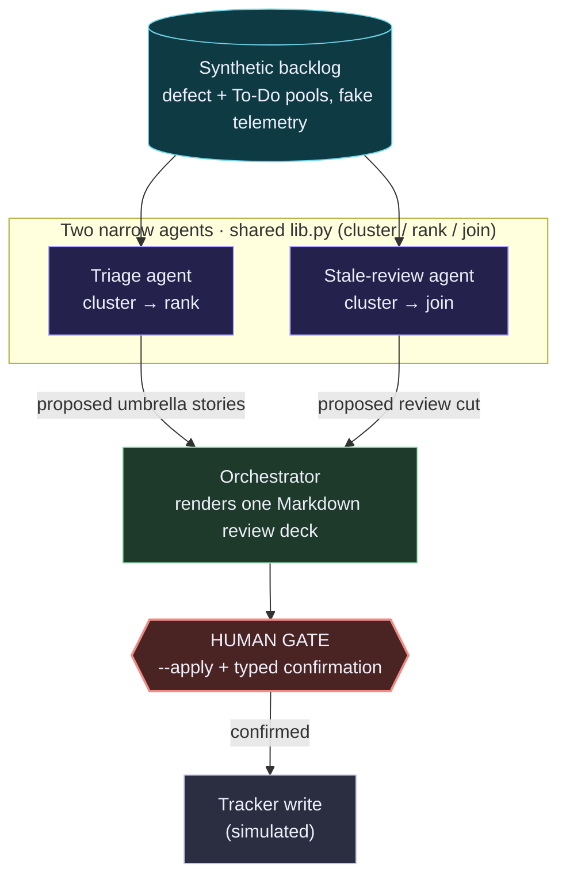

# Architecture

Colors mark the kind of step: data, deterministic code, output, human decision, external system. The only path to a write runs through the human gate.

## Design decisions

**Why two narrow agents instead of one general one.** Triage and stale-review are different problems with different failure modes — triage is about finding the highest-impact grouping across noisy, duplicate-heavy input; stale-review is about surfacing neglect. Keeping them separate means each can be tested, tuned, and reasoned about independently, and a bug in one can't silently corrupt the other's output.

**Why clustering + ranking are separate, reusable functions (`lib.py`), not inlined in each agent.** The reasoning steps a reviewer needs to trust — "how did it decide these three tickets are the same root cause," "how did it decide this cluster outranks that one" — are each one small, unit-testable function. That's what makes the agent's output auditable rather than a black box.

**Why the gate is structural, not a suggestion.** The orchestrator will print a full proposal on every run, gate-free. The only way anything gets "applied" is `--apply` plus a typed confirmation string — there's no flag that skips both. In the version of this pattern I run in production, that gate is a real tracker write requiring the confirmation; here it's a print statement standing in for that, since there's no tracker to actually write to.

**Why telemetry breaks ties instead of recency or filer.** The most common failure mode in backlog triage is prioritizing whoever complained most recently or most loudly. Grounding the ranking in a real signal (here, synthetic telemetry hit counts) makes the "why this and not that" question answerable with a number instead of a guess.

## What this is not

This is not a reproduction of any employer's code, data, system names, or output. It's a clean-room rebuild of a pattern — narrow agents, human-gated writes, telemetry-grounded prioritization — against synthetic data, written to demonstrate the underlying design thinking rather than any specific implementation.
