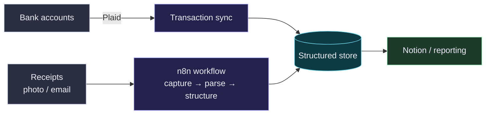

# Artha.ai — Personal Finance Automation

A personal finance automation platform I built and use myself. The name (Sanskrit/Telugu, roughly "wealth" or "meaningful pursuit of resources") reflects the goal: automate the tedious parts of tracking money so the only decisions left are the ones that actually matter.

## What it does

- **Bank transaction syncing** via Plaid, pulling transactions across accounts automatically instead of manual CSV exports.
- **Receipt parsing** via an n8n workflow — receipts get captured and parsed into structured line items automatically rather than typed in by hand.
- Connected into a broader personal tooling stack (Notion, Gmail, Google Calendar, Google Drive) so financial data lands where the rest of my planning already lives, rather than in a siloed app.

## Architecture

n8n (self-hosted workflow automation) is the orchestration layer — it's what makes "receipt comes in → gets parsed → lands as structured data" happen without a human in the loop for the routine case.

## Why it's here

This is the project that proves the FDE pattern outside of a work context: picking a real, personally-felt problem, wiring together a bank data API, a workflow automation tool, and a document-parsing step, and running the result myself, on my own money, continuously — not a tutorial project abandoned after the demo worked once.

## Status & limitations

This is a live personal tool, not a packaged open-source project — the codebase isn't structured for public release in its current form, so this page is a writeup rather than a full code mirror. Happy to walk through the actual implementation, workflows, and architecture decisions in more depth live.
