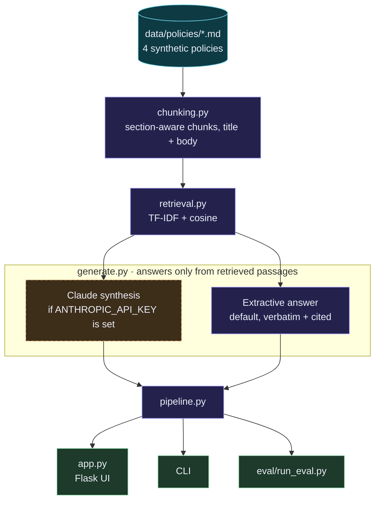

# Healthcare Prior-Authorization Policy RAG

A retrieval-augmented Q&A system over synthetic payer prior-authorization policies (ophthalmology domain — cataract/IOL, diabetic retinopathy screening, glaucoma/MIGS surgery, plus a claim-denial-code reference), with real evaluation, not just a demo that looks like it works.

## Why this project

Most FDE-style RAG portfolios pull from generic corporate policy PDFs. This one pulls from a domain I actually know: healthcare payer/provider interoperability, prior-authorization criteria, and claims/denial workflows, built on 13+ years in healthcare IT including HL7/FHIR integration work. All policy documents here are **synthetic — written for this demo, not scraped or reproduced from any real payer's published policy.**

## Problem

A provider's office or a claims team needs a fast, cited answer to "what does policy X require for procedure Y" without reading five PDFs, and needs the system to say "I don't know" rather than hallucinate a criterion that isn't actually in the policy.

## Architecture



**Retrieval is classical IR (TF-IDF), not an embedding model or an LLM call.** Over a small, fixed policy corpus this is a deterministic, zero-cost, zero-latency choice that a reviewer can run with no API key and no setup — the same judgment call the FDE pattern rewards: don't reach for a probabilistic/expensive tool when a deterministic one solves the actual problem.

**Generation has an honest two-path design.** If `ANTHROPIC_API_KEY` is set, it calls Claude to synthesize a grounded, cited answer. If not — the default for anyone cloning this without configuring secrets — it falls back to extractive synthesis: the top-matching passages, verbatim, clearly cited, no generation at all. Both paths cite chunk IDs; neither ever answers from outside the retrieved passages, and both say "I don't know" when nothing matches.

## Evaluation

`eval/eval_set.json` has 12 hand-written questions against the policy set, each with a known correct source chunk and expected keywords. `eval/run_eval.py` runs the full pipeline against each and reports:

```
{
  "n_questions": 12,
  "retrieval_hit@3": 1.0,
  "retrieval_mrr": 0.861,
  "avg_keyword_coverage": 0.917,
  "avg_latency_ms": 0.68,
  "cost_per_query_usd": 0.0,
  "mode": "extractive (no ANTHROPIC_API_KEY set)"
}
```

**What the eval caught, and what I did about it** — this is the part that matters more than the numbers:

1. **First pass:** the top-ranked chunk for "what documentation is required for a toric IOL" was the document's *preamble* (just doc ID/category metadata) — it won on keyword overlap with "prior authorization" without containing any real policy content. Fix: excluded preamble/metadata chunks from the retrievable pool (`retrieval.py`).
2. **Second pass, still wrong:** after that fix, a *different document's* "Required Documentation" section outranked the correct one, because the correct chunk's body text never repeats words like "IOL" or "toric" — that context lives only in the document title, which wasn't part of what got indexed. Fix: index on `title + body`, not body alone (a standard RAG pattern — contextual chunk headers — that I only added because the eval surfaced the failure, not because I assumed it up front).
3. **Known, unfixed limitation (Q10 in the eval set):** retrieval correctly finds the right passage for "what do I do about denial code SYN-197," but the extractive answer's 600-character truncation cuts off the reference table before reaching that row, so the expected keyword never makes it into the final answer text. Root cause is understood (naive character-count truncation on a multi-row table chunk) and the fix is straightforward (table-aware truncation, or raise the limit for table-type chunks) — left as-is here as an honest example of a caught-but-not-yet-fixed failure mode, which is closer to what a real eval-driven hardening backlog looks like than a suite with no visible misses.

## Run it

```bash
pip install -r requirements.txt

# CLI, single question:
python3 src/pipeline.py "What documentation is required for a toric IOL prior authorization?"

# Full eval suite:
python3 eval/run_eval.py

# Web UI:
python3 app.py   # then open http://localhost:5050
```

No API key needed for any of the above — extractive mode is the default. Set `ANTHROPIC_API_KEY` to switch generation to LLM-synthesized answers (still grounded and cited the same way).

## Limitations & what I'd harden next

- TF-IDF has no semantic understanding — a question that uses none of the policy's actual vocabulary (a true paraphrase) will underperform an embedding-based retriever. Worth an embedding-based retriever + reranker as a follow-up, with the same eval set as the regression check.
- The extractive-mode truncation bug above (Q10) is a known, understood gap.
- The policy set is deliberately small (4 documents, 15 retrievable chunks) to keep this reviewable end-to-end; a real system needs chunking and retrieval tuning validated at real corpus scale.
- No re-ranking step; at larger corpus scale, a cross-encoder reranker on top of TF-IDF's candidate set would likely close most of the remaining retrieval gap.

## Related

[`../agentic-delivery-tooling/`](../agentic-delivery-tooling/) — the other project in this portfolio, a clean-room reconstruction of an agent pattern from my current role.
